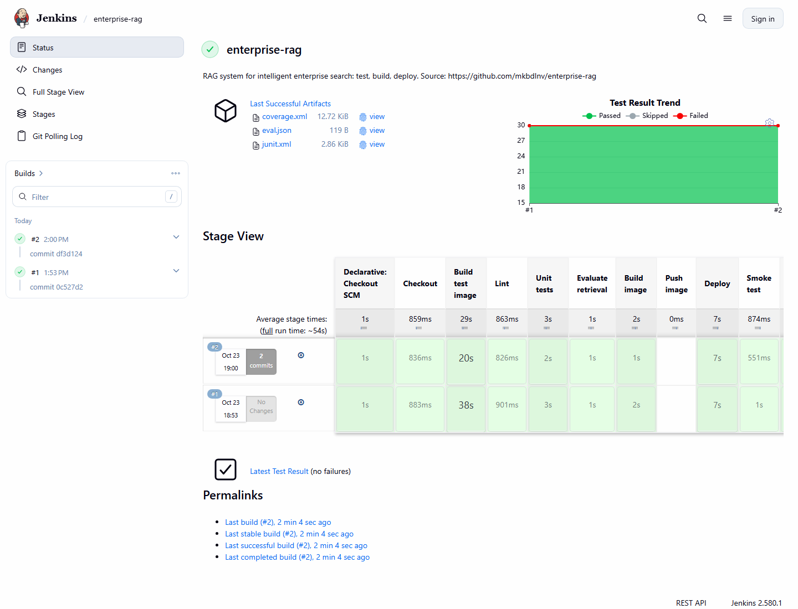
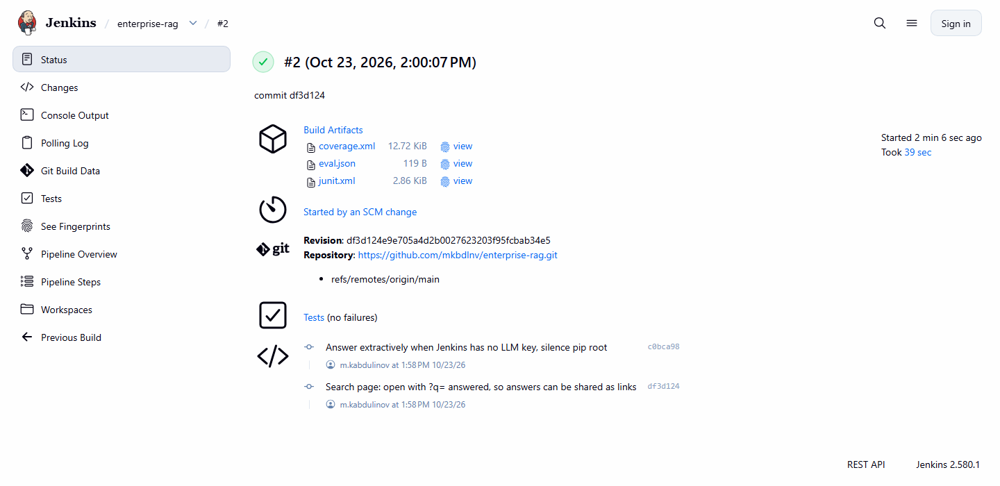
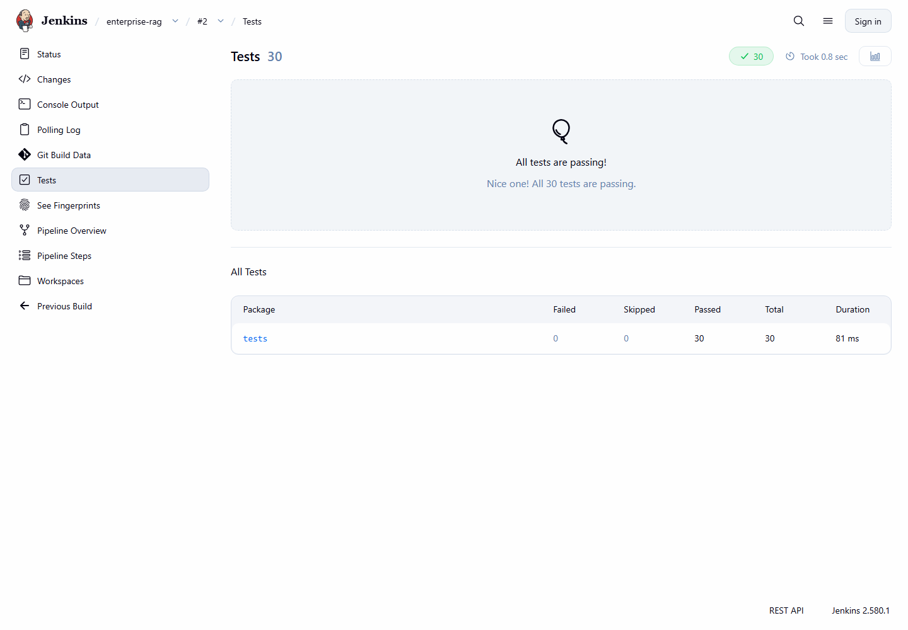
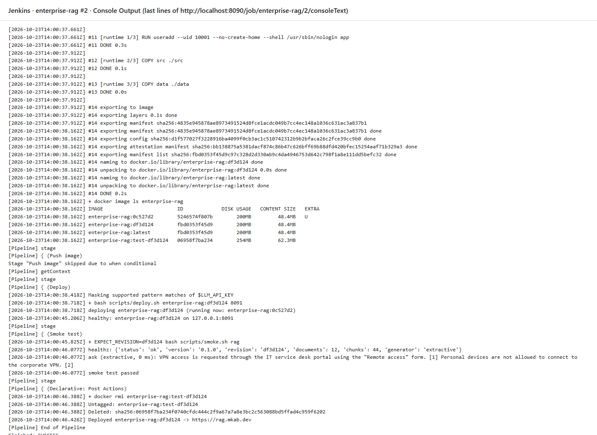
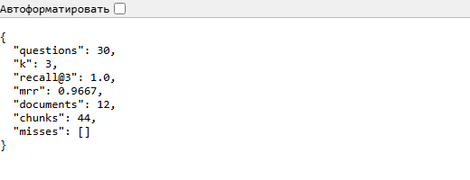
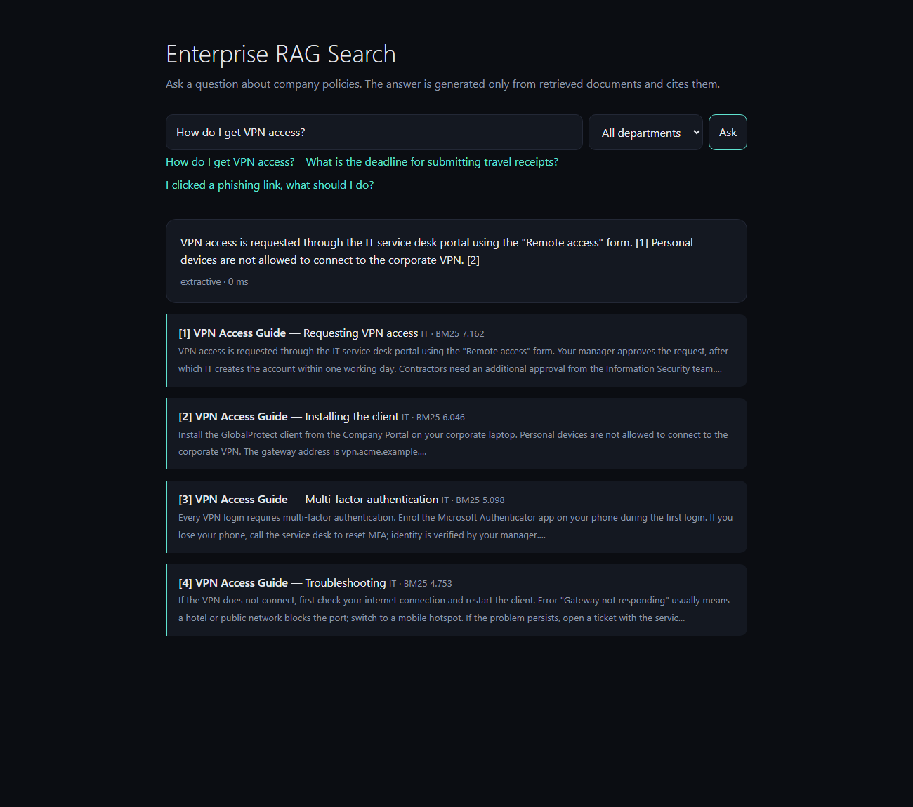
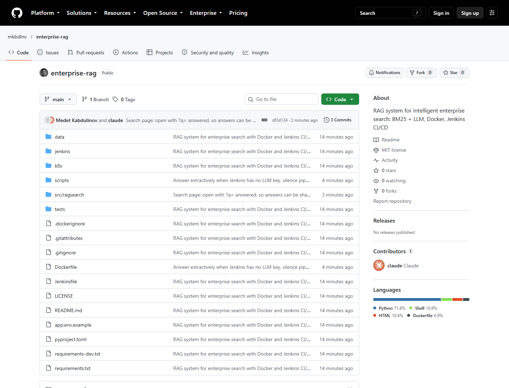

# Часть 1. Теоретическая часть

## Введение

Тема моей диссертации — RAG-система (Retrieval-Augmented Generation) для интеллектуального корпоративного поиска. Она находит фрагменты корпоративных документов, а затем языковая модель (LLM) формулирует по ним ответ [1]. Система состоит из цепочки компонентов: нарезки документов, индекса, промпта, внешней модели и набора вопросов для оценки. Все они часто меняются в ходе исследования, и любое изменение может незаметно ухудшить ответы. Ниже разобраны DevOps и CI/CD и их применение в прототипе.

## 1. Что такое DevOps: цели, принципы и преимущества

DevOps — это культура и набор практик, которые убирают стену между разработкой и эксплуатацией. Термин появился около 2009 года вместе с конференцией DevOpsDays Патрика Дебуа как ответ на медленные и рискованные ручные релизы. Главная цель DevOps — доставлять изменения пользователям **быстро, безопасно и многократно**.

Принципы DevOps обычно сводят к аббревиатуре **CALMS**:

- **Culture (культура)** — общая ответственность за продукт от первого коммита до работы в продакшене;
- **Automation (автоматизация)** — всё, что делается больше двух раз (сборка, тесты, развёртывание, настройка инфраструктуры), делает машина;
- **Lean (бережливость)** — небольшие порции изменений, короткие циклы обратной связи, ограничение незавершённой работы;
- **Measurement (измерения)** — решения принимаются по данным: время сборки, доля сбоев, метрики качества;
- **Sharing (обмен)** — знания, код и конфигурация открыты всей команде.

Исследования группы DORA, обобщённые в книге *Accelerate* [2], показали, что сильные команды отличают четыре метрики: частота развёртываний, время от коммита до продакшена, доля неудачных изменений и время восстановления после сбоя. Команды, которые автоматизируют доставку, развёртывают чаще *и при этом* реже ломают систему. Это опровергает интуицию, будто скорость обходится ценой стабильности.

Главные преимущества DevOps — быстрая обратная связь, меньше ручных ошибок, воспроизводимые окружения, быстрый откат и полная история всех изменений, результатов тестов и развёртываний.

## 2. Обзор CI/CD

**Непрерывная интеграция (Continuous Integration, CI)** — практика, при которой изменения разработчиков часто, хотя бы раз в день, вливаются в основную ветку. Каждое изменение автоматически запускает сборку и тесты, поэтому поломка видна через несколько минут и исправляется до продолжения работы. Для CI нужны система контроля версий (Git), автоматическая сборка, быстрые и надёжные тесты и CI-сервер, который запускает их на каждый коммит.

**Непрерывная доставка (Continuous Delivery, CD)** развивает CI. Каждое изменение, прошедшее конвейер, даёт кандидата в релиз, например Docker-образ, и его *можно* выкатить в продакшен в любой момент одной кнопкой [3]. **Непрерывное развёртывание (Continuous Deployment)** идёт дальше и выкатывает каждое успешное изменение автоматически.

CI/CD-конвейер обычно описывают как последовательность этапов:

| Этап | Назначение |
|---|---|
| Source | коммит или pull request запускает конвейер |
| Build | установка зависимостей, сборка артефакта или образа контейнера |
| Test | статический анализ, модульные и интеграционные тесты, пороги качества |
| Publish | публикация артефакта в реестр с тегом версии |
| Deploy | выкатка в тестовое окружение, затем в продакшен |
| Verify | проверки здоровья, smoke-тесты, мониторинг; откат при сбое |

Сам конвейер хранится как код (`Jenkinsfile`, `.gitlab-ci.yml` или workflow GitHub Actions) рядом с приложением. Поэтому его версионируют, проверяют на ревью и воспроизводят, как любой другой код.

## 3. Роль DevOps-инструментов в исследовательской среде

У научного ПО есть свои проблемы, и DevOps-инструменты решают их напрямую.

**Воспроизводимость.** Результат из статьи должен повторить другой исследователь или сам автор через год. На практике результат зависит от версий библиотек, системных пакетов, случайных зёрен и снимков данных. Контейнер фиксирует всё программное окружение в образе, а закреплённые версии зависимостей и данные в Git фиксируют остальное. Боттигер [4] показал, что Docker устраняет самые частые причины невоспроизводимости вычислительных исследований: конфликт зависимостей, неточную документацию и «старение» кода.

**Надёжность результатов.** Исследовательский код часто пишут быстро и проверяют вручную. Автоматические тесты ловят регрессии в алгоритмах. Для систем машинного обучения и информационного поиска в тесты можно включить *порог качества*: метрику на фиксированном наборе данных, которая не должна опускаться ниже заданного значения. Тогда фраза «кажется, новая нарезка лучше» превращается в измеренный и записанный факт.

**Совместная работа.** В паре «студент — научный руководитель» CI даёт нейтральную оценку того, работает ли код, независимо от чьего-то ноутбука.

**Скрытый технический долг ML-систем.** Скалли и соавторы [5] показали, что в реальных ML-системах сама модель — лишь малая часть кода. Остальное — сбор данных, конфигурация, обслуживание и мониторинг. RAG-система — типичный пример: «интеллект» в ней — это несколько промптов и индекс, а основной риск лежит в окружающем конвейере. Практики DevOps и их ML-расширение MLOps/LLMOps делают эту инфраструктуру явной и тестируемой.

Для RAG-системы DevOps добавляет к обычному веб-сервису ещё четыре задачи. Индекс нужно воспроизводимо перестраивать при изменении корпуса. Качество поиска (Recall@k, MRR) и достоверность ответов нужно оценивать на каждом изменении. Внешние LLM-API ограничивают частоту запросов и могут отказать, поэтому системе нужен запасной вариант. Ключи API — это секреты, их нельзя хранить в коде или писать в логи.

## 4. Примеры использования Docker, Jenkins и Kubernetes в научных и инженерных проектах

**Docker** упаковывает приложение с зависимостями в образ, который одинаково работает на ноутбуке, CI-сервере и в облаке [6]. В науке так публикуют точное окружение статьи: сервис Binder собирает контейнер из репозитория, и читатель запускает ноутбуки авторов в браузере. Проект BioContainers распространяет тысячи контейнеризированных биоинформатических инструментов. На HPC-кластерах, где Docker с правами root запрещён, те же образы запускает Singularity/Apptainer [7].

**Jenkins** — открытый сервер автоматизации (форк Hudson 2011 года) с тысячей плагинов и конвейерами в виде кода. Исследовательские организации ценят его за работу на собственных серверах, рядом с закрытыми данными и специальным оборудованием. Например, команды ЦЕРН давно используют Jenkins для ночных сборок и тестов крупных физических фреймворков. Шаги конвейера могут выполняться в Docker, поэтому воспроизводимо и окружение сборки.

**Kubernetes** распределяет контейнеры по кластеру, перезапускает упавшие, обновляет без простоя и масштабирует сервисы [8]. В науке на нём работают JupyterHub для курсов и лабораторий, движки workflow (Argo Workflows, Nextflow) и ML-платформы вроде Kubeflow. Частное облако ЦЕРН предлагает учёным кластеры Kubernetes как услугу. Для небольших проектов есть Minikube и k3s, где те же манифесты работают на одной машине.

**Применение в моём проекте.** Прототип диссертации (репозиторий `github.com/mkbdlnv/enterprise-rag`) использует все три инструмента:

- **многоэтапный Dockerfile** собирает из одного файла два образа: тестовый (pytest и Ruff) и минимальный рабочий, который запускается не от root и проверяет своё здоровье;
- **Jenkins**, сам описанный как код (список плагинов, YAML Configuration as Code, Job DSL), опрашивает Git-репозиторий и запускает конвейер. Шаги такие: линтер → модульные тесты (публикуются как отчёт JUnit) → оценка поиска (Recall@3 и MRR сохраняются как артефакт сборки, а тесты валят сборку при Recall@3 < 0,9) → рабочий образ → выкатка на тестовый сервер с автоматическим откатом, если новый контейнер не стал здоровым → smoke-тест на живом сервисе;
- **манифест Kubernetes** описывает тот же сервис как Deployment из двух реплик с проверками готовности и живости и плавным обновлением; он готов для Minikube или k3s.

В итоге каждый эксперимент с поиском или промптом — это коммит. Его влияние на качество поиска измеряется и записывается, а если проверки пройдены, изменение примерно через две минуты работает на https://rag.mkab.dev.

## 5. Заключение: какие проблемы DevOps решает в научных командах

DevOps превращает исследовательское ПО из хрупкого личного артефакта в воспроизводимую, проверяемую и постоянно доступную систему. Он решает пять проблем научных команд: невоспроизводимые окружения (решение — контейнеры и инфраструктура как код), незаметные регрессии (тесты и пороги качества на каждом коммите), ручные рискованные релизы (конвейеры с проверкой здоровья и откатом), отсутствие прослеживаемости (каждый результат связан с коммитом, сборкой и образом) и знания в голове одного человека (всё описано кодом).

Для RAG-системы это особенно важно: её качество зависит от многих компонентов и от внешних моделей, которые меняются со временем. Автоматизация оценки и доставки позволяет экспериментировать быстро и обосновать каждый результат диссертации.

## Список литературы

1. Lewis P. et al. Retrieval-Augmented Generation for Knowledge-Intensive NLP Tasks. *Advances in Neural Information Processing Systems 33 (NeurIPS)*, 2020.
2. Forsgren N., Humble J., Kim G. *Accelerate: The Science of Lean Software and DevOps.* IT Revolution Press, 2018.
3. Humble J., Farley D. *Continuous Delivery: Reliable Software Releases through Build, Test, and Deployment Automation.* Addison-Wesley, 2010.
4. Boettiger C. An introduction to Docker for reproducible research. *ACM SIGOPS Operating Systems Review*, 49(1), 2015, pp. 71–79.
5. Sculley D. et al. Hidden Technical Debt in Machine Learning Systems. *NeurIPS*, 2015.
6. Merkel D. Docker: lightweight Linux containers for consistent development and deployment. *Linux Journal*, 2014(239).
7. Kurtzer G. M., Sochat V., Bauer M. W. Singularity: Scientific containers for mobility of compute. *PLoS ONE*, 12(5), 2017.
8. Burns B., Grant B., Oppenheimer D., Brewer E., Wilkes J. Borg, Omega, and Kubernetes. *Communications of the ACM*, 59(5), 2016.

```{=openxml}
<w:p><w:r><w:br w:type="page"/></w:r></w:p>
```

# Часть 2. Практическая часть: CI/CD-конвейер для Python-проекта на Docker и Jenkins

**Репозиторий с проектом и Jenkinsfile:** https://github.com/mkbdlnv/enterprise-rag (Jenkinsfile лежит в корне). **Развёрнутый сервис:** https://rag.mkab.dev. **Jenkins:** `127.0.0.1:8090` на том же сервере, открывается через SSH-туннель.

## Проект

Исследовательский проект — прототип моей диссертации: RAG-система корпоративного поиска на Python 3.12 и FastAPI. Она индексирует 12 документов с политиками компании (44 фрагмента) и ищет нужные фрагменты алгоритмом BM25. Затем языковая модель пишет ответ со ссылками на источники; без модели система отвечает цитатами из найденных фрагментов. На 30 размеченных вопросах Recall@3 = 1,0, MRR = 0,967.

## Шаги

1. **Git.** Код, данные, тесты, Dockerfile, Jenkinsfile и конфигурация Jenkins лежат в одном репозитории на GitHub. Jenkins собирает каждый коммит в `main`.
2. **Dockerfile.** Сборка многоэтапная. `base` содержит закреплённые зависимости. `test` добавляет pytest и Ruff, его использует CI. `runtime` содержит только код и данные, работает не от root и имеет `HEALTHCHECK`. Его содержимое — 48 МБ.
3. **Сервер Jenkins.** Jenkins LTS 2.580.1 работает в Docker на VPS с 1 vCPU и 2 ГБ памяти и полностью описан кодом. Образ добавляет Docker CLI и плагины. Configuration as Code создаёт администратора, учётные данные с ключом LLM и задачу (Job DSL). Compose-файл ограничивает память 768 МБ и подключает Docker-сокет. Сервер настраивается одним скриптом.
4. **CI-конвейер.** Запускается опросом репозитория (`pollSCM`) каждые 2 минуты. Этапы: Checkout → сборка тестового образа → линтер (Ruff) → модульные тесты (30 тестов pytest, отчёт JUnit, покрытие 96 %) → оценка поиска (`eval.json` сохраняется; при Recall@3 < 0,9 сборка падает) → сборка образа `enterprise-rag:<sha>` → push. Push необязателен и включается переменной `PUSH_IMAGE=true` и учётными данными реестра.
5. **CD (бонус).** Скрипт `scripts/deploy.sh` заменяет контейнер сервиса и ждёт проверки здоровья. Если новая версия так и не становится здоровой, он возвращает предыдущий образ и валит сборку. Smoke-тест отправляет настоящие запросы и проверяет, что работает новая ревизия. В репозитории есть и манифест Kubernetes для Minikube/k3s.

Первая сборка запустилась сама (*«Started by an SCM change»*) и заняла 69 с, следующая — 39 с, потому что слои с зависимостями взялись из кэша. Все этапы прошли успешно.

## Трудности

- **2 ГБ памяти на все сервисы.** Для Jenkins задан лимит кучи JVM и лимит памяти контейнера. Сборки идут в Docker-демоне хоста, а Python-инструменты лежат в тестовом образе, так что агенту нужны только git и Docker.
- **Права на Docker-сокет.** Пользователь `jenkins` не мог обратиться к `/var/run/docker.sock`. Решение — добавить контейнеру группу сокета (`group_add`).
- **Секреты.** Переменные окружения процесса Jenkins видны каждому шагу `sh`. Поэтому Configuration as Code читает секреты из файлов. Ключ LLM хранится как учётные данные Jenkins, маскируется в логе и передаётся в контейнер как `-e LLM_API_KEY` без значения.
- **Нет вебхука.** Jenkins доступен только через SSH, поэтому GitHub не может вызвать вебхук. Его заменяет опрос репозитория раз в 2 минуты.
- **Windows и Linux.** `.gitattributes` задаёт окончания строк LF. Команды для сервера отправляются файлами-скриптами, потому что PowerShell портит кавычки в аргументах `ssh`.
- **Внешняя LLM в тестах.** HTTP-вызов подменяется заглушкой. Тесты проверяют промпт, цепочку запасных моделей и ответ без модели, не выходя в сеть.

## Выводы

Каждый коммит меньше чем за минуту становится протестированной, измеренной и развёрнутой версией без ручных шагов. Закреплённые зависимости и образы делают окружение воспроизводимым, а сохранённый `eval.json` связывает каждую цифру качества с коммитом. Для исследований RAG порог качества по метрике в CI не менее важен, чем модульные тесты: именно он решает, принять ли изменение нарезки, токенизации или промпта. Дальше в планах — гибридный поиск, метрика достоверности ответов в том же пороге и публикация образов в реестр.

```{=openxml}
<w:p><w:r><w:br w:type="page"/></w:r></w:p>
```

# Приложение. Скриншоты

{width=16cm}

{width=16cm}

{width=16cm}

{width=16cm}

{width=8cm}

{width=14cm}

{width=16cm}
